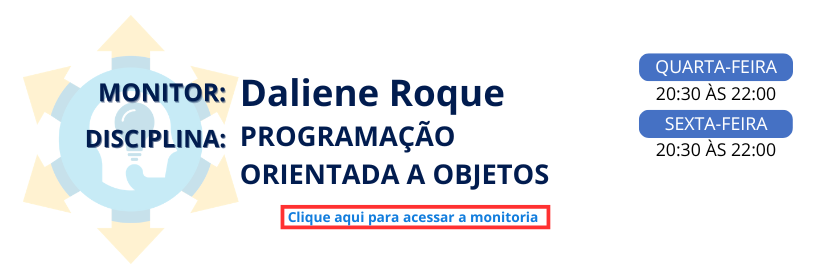

 <div align="center">

# 🏁 Monitoria de Programação Orientada a Objetos (POO) - Java

### Programa Ampliar • Unicesumar • Módulo 54 em 2026 • Projeto Prático: Jogo de Corrida




**Aprenda Programação Orientada a Objetos em Java por meio do desenvolvimento de um jogo de corrida!**

</div>

---

## 📚 Sobre este repositório

Este repositório reúne os **materiais, códigos, exercícios, desafios e atividades práticas** desenvolvidos durante as monitorias de **Programação Orientada a Objetos (POO) em Java — Módulo 54** do Programa Ampliar da Unicesumar.

A proposta foi trabalhar os conceitos de POO de maneira **prática, progressiva e baseada em um projeto**.

O projeto principal desenvolvido durante as monitorias foi um **Jogo de Corrida em Java**, utilizando a biblioteca Swing para a construção da interface gráfica.

Em vez de apresentar os conceitos de POO apenas de forma teórica, cada conteúdo foi relacionado à implementação do próprio jogo.

Durante as atividades, foram trabalhados conceitos como:

- Classes e objetos;
- Atributos e métodos;
- Construtores;
- Encapsulamento;
- Herança;
- Polimorfismo;
- Classes abstratas;
- Sobrescrita de métodos;
- Relacionamento entre classes;
- Reutilização de código;
- Organização do código.

O objetivo foi demonstrar como os conceitos de POO podem ser aplicados na construção de uma aplicação funcional.

---

# 🔗 Continuidade do Módulo 53

O Módulo 54 dá continuidade aos estudos realizados no **Módulo 53**.

O repositório anterior possui materiais, exemplos, exercícios e conteúdos importantes que podem ser utilizados como base de consulta e revisão.

📚 **Acesse o repositório do Módulo 53:**

👉 [Programa Ampliar • Unicesumar • Módulo 53](https://github.com/dalieneroque/Programa-Ampliar-Unicesumar-2026-Modulo-53)

Os conhecimentos desenvolvidos anteriormente foram retomados e utilizados durante esta nova etapa.

A proposta do Módulo 54 foi evoluir a experiência prática, utilizando um novo projeto para aplicar os conceitos de POO de maneira integrada.

> 📚 **Módulo 53** → Fundamentos, materiais e práticas iniciais
>
> 🏎️ **Módulo 54** → Aplicação prática e desenvolvimento do Jogo de Corrida

---

# 🏎️ Projeto: Jogo de Corrida

O projeto principal desenvolvido durante as monitorias foi um **jogo de corrida em Java**, utilizando Programação Orientada a Objetos e a biblioteca Swing.

A aplicação permite que diferentes tipos de veículos participem de uma corrida, cada um com seu próprio comportamento de aceleração.

O projeto foi utilizado como laboratório prático para demonstrar como classes, objetos, herança e polimorfismo trabalham juntos na construção de um sistema.

---

## 🏁 Como funciona o jogo?

O jogo apresenta diferentes veículos participando de uma corrida. O objetivo é acompanhar a movimentação dos participantes e identificar qual veículo alcança primeiro a linha de chegada.

### 🚗 Veículos participantes

- 🏎️ **Carro:** possui aceleração progressiva;
- 🏍️ **Moto:** possui aceleração variável;
- 🚛 **Caminhão:** possui aceleração mais moderada.

### ⚙️ Funcionamento da corrida

- Os veículos são posicionados na linha de largada;
- A corrida é iniciada ao pressionar a tecla `ENTER`;
- Cada veículo executa sua própria regra de aceleração;
- A posição e a velocidade dos veículos são atualizadas durante a corrida;
- A movimentação é apresentada graficamente na tela;
- Ao alcançar a linha de chegada, o vencedor é anunciado.

### 🖥️ Recursos implementados

- Interface gráfica utilizando Java Swing;
- Representação visual dos veículos;
- Movimentação dos veículos durante a corrida;
- Diferentes regras de aceleração;
- Controle da corrida por temporizador;
- Identificação da linha de chegada;
- Exibição do nome e da velocidade dos participantes;
- Identificação e anúncio do vencedor;
- Reinicialização dos veículos para uma nova corrida.

---

# 🧠 Aprendendo POO através do jogo

A proposta foi fazer com que cada conceito de POO fosse apresentado e relacionado a uma necessidade do projeto.

Por exemplo:

```text
Precisamos representar diferentes veículos
              ↓
       Criamos uma classe
              ↓
       Criamos objetos
              ↓
       Definimos atributos
              ↓
       Implementamos métodos
              ↓
       Utilizamos construtores
              ↓
       Aplicamos encapsulamento
              ↓
       Criamos diferentes tipos de veículos
              ↓
       Utilizamos herança
              ↓
       Aplicamos polimorfismo
              ↓
       Trabalhamos com classe abstrata
              ↓
       Implementamos comportamentos específicos
              ↓
       Construímos o jogo de corrida
```

Dessa forma, os alunos puderam compreender não apenas o que é POO, mas também por que determinados conceitos são importantes durante o desenvolvimento de um projeto.

---

# 🎯 Objetivos da monitoria

Durante as monitorias, os alunos foram estimulados a:

- Compreender os fundamentos da Programação Orientada a Objetos;
- Desenvolver aplicações utilizando Java;
- Praticar lógica de programação;
- Criar e organizar classes;
- Trabalhar com objetos;
- Aplicar encapsulamento;
- Utilizar herança e polimorfismo;
- Compreender relacionamentos entre classes;
- Desenvolver código reutilizável;
- Resolver problemas através da programação;
- Aplicar os conhecimentos em um projeto prático.

---

# 🗂️ Cronograma das Monitorias

O desenvolvimento das atividades foi organizado de maneira progressiva, acompanhando a introdução dos conceitos de POO e sua aplicação no projeto.

| Etapa | Conteúdo / Desenvolvimento | Situação |
|:---:|---|:---:|
| 01 | Apresentação do projeto e ideia do jogo | Concluído |
| 02 | Classes e Objetos: criando os primeiros veículos | Concluído |
| 03 | Atributos e Métodos: características e ações | Concluído |
| 04 | Construtores: criando veículos | Concluído |
| 05 | Encapsulamento: protegendo os dados | Concluído |
| 06 | Herança: diferentes tipos de veículos | Concluído |
| 07 | Polimorfismo: comportamentos diferentes | Concluído |
| 08 | Classes Abstratas | Concluído |
| 09 | Sistema de largada e corrida | Concluído |
| 10 | Representação gráfica dos veículos | Concluído |
| 11 | Movimentação e aceleração dos veículos | Concluído |
| 12 | Identificação do vencedor e reinicialização | Concluído |
| 13 | Integração, exercícios e desafios do projeto | Concluído |

---

# 📁 Organização do Repositório

O repositório está organizado para facilitar o acesso ao código-fonte e aos materiais utilizados durante as monitorias.

```text
📦 Programa-Ampliar-Unicesumar-2026-Modulo-54-POO-Projeto-Pratico
│
├── 📂 Jogo-Corrida
│   │
│   ├── 📂 Desafios
│   │
│   ├── 📂 Exercicios
│   │
│   ├── 📂 Recursos
│   │
│   └── 📂 src
│
├── 📄 README.md
│
└── 🖼️ image.png
```

- **Jogo-Corrida:** código-fonte do projeto desenvolvido;
- **Exercicios:** atividades para fixação dos conteúdos;
- **Desafios:** propostas práticas para evolução do projeto;
- **Recursos:** materiais complementares de aprendizagem.

---

# 💻 Tecnologias utilizadas

- ☕ Java;
- 🖥️ Java Swing;
- 💻 Visual Studio Code;
- 🔧 Git;
- 🐙 GitHub.

---

# 🚀 Como utilizar este repositório

### 1️⃣ Acesse o projeto

Entre na pasta:

```text
Jogo-Corrida
```

Consulte os arquivos e conheça a estrutura do projeto.

### 2️⃣ Estude o código

Observe como os conceitos de POO foram aplicados nas diferentes classes do jogo.

### 3️⃣ Execute o projeto

Abra o projeto no **Visual Studio Code**, configure o ambiente Java e execute a aplicação.

### 4️⃣ Modifique o jogo

Experimente realizar alterações nos atributos, métodos e comportamentos dos veículos.

### 5️⃣ Resolva os exercícios e desafios

Acesse as pastas `Exercicios` e `Desafios` para praticar os conteúdos estudados.

### 6️⃣ Explore novas possibilidades

Utilize sua criatividade para propor melhorias e novas funcionalidades para o jogo.

---

# 🎯 Conceitos de POO aplicados ao projeto

O projeto foi utilizado para demonstrar os principais conceitos de Programação Orientada a Objetos:

```text
                  🏎️ JOGO DE CORRIDA
                         │
                         ↓
                       CLASSES
                         │
                         ↓
                       OBJETOS
                         │
                         ↓
                      ATRIBUTOS
                         │
                         ↓
                       MÉTODOS
                         │
                         ↓
                     CONSTRUTORES
                         │
                         ↓
                   ENCAPSULAMENTO
                         │
                         ↓
                       HERANÇA
                         │
                         ↓
                    POLIMORFISMO
                         │
                         ↓
                 CLASSES ABSTRATAS
                         │
                         ↓
                  🏁 JOGO FUNCIONAL
```

---

# 💡 Metodologia

A metodologia utilizada foi baseada em **aprendizagem prática, desenvolvimento incremental e resolução de problemas**.

Durante as monitorias, os conteúdos foram trabalhados por meio de uma sequência que relacionava teoria e prática:

```text
🏁 Apresentação de um problema
             ↓
💭 Raciocínio lógico
             ↓
📚 Explicação do conceito de POO
             ↓
💻 Implementação no código
             ↓
🏎️ Aplicação no jogo
             ↓
🧪 Testes e observação dos resultados
             ↓
🎯 Exercícios e desafios
```

O desenvolvimento do jogo permitiu que os alunos acompanhassem a aplicação dos conceitos diretamente no código, compreendendo como diferentes partes de um sistema trabalham em conjunto.

Além da implementação, foram propostas perguntas, exercícios e desafios para estimular o raciocínio lógico, a participação e a autonomia na resolução de problemas.

---

# 🏆 Resultados alcançados

Ao longo das monitorias, foi desenvolvido um **jogo de corrida em Java**, utilizando os conceitos fundamentais da Programação Orientada a Objetos.

A atividade proporcionou uma experiência prática de desenvolvimento de software, permitindo relacionar os conteúdos estudados com situações reais de implementação.

Entre os resultados alcançados, destacam-se:

- Construção de uma aplicação funcional em Java;
- Aplicação dos conceitos de POO em um projeto integrado;
- Criação de diferentes tipos de veículos;
- Implementação de comportamentos específicos para cada veículo;
- Desenvolvimento de uma interface gráfica com Swing;
- Prática de leitura, interpretação e modificação de código;
- Elaboração de exercícios e desafios para reforçar a aprendizagem.

Mais importante do que simplesmente finalizar o jogo foi compreender **como as diferentes partes do sistema foram planejadas e implementadas**.

Durante o desenvolvimento, os alunos foram estimulados a refletir sobre questões como:

> **"Por que criamos essa classe?"**

> **"Qual é a responsabilidade desse objeto?"**

> **"Por que esse atributo pertence a essa classe?"**

> **"Quando devemos utilizar um método?"**

> **"Onde podemos utilizar herança?"**

> **"Como o polimorfismo pode ajudar nosso jogo?"**

A proposta foi transformar os conceitos de POO em **código funcionando, compreensível e aplicado a um projeto prático**.

---

# 🎥 Aulas da Monitoria

Acesse as aulas e materiais pelo link abaixo:

🔗 [Programa Ampliar — Programação Orientada a Objetos](https://sites.google.com/view/programa-ampliar/sobre-o-programa-ampliar?authuser=0)

Acesse também os slides utilizados nas monitorias de Programação Orientada a Objetos (POO) em Java:

🔗 [Acessar os slides da monitoria](https://gamma.app/docs/POO-na-pratica-construindo-um-jogo-de-corrida-em-Java-ou8arerlwq7dl48?mode=doc)

---

<div align="center">

## 🏁 Bons estudos e boa corrida!

**"A melhor forma de aprender programação é programando."**

</div>

---

<div align="center">

[](https://www.linkedin.com/in/daliene-roque-a5b167269/)
[](https://github.com/DalieneRoque)
[](https://www.youtube.com/channel/UCzS1CS4ll7-4kWyIwYVhz9w)
[](https://discord.gg/5EsYDnNDky)
[](https://www.instagram.com/dalieneroque/)
[](https://linktr.ee/dalieneroque)

**Daliene Nonato Lima Roque**

</div>
